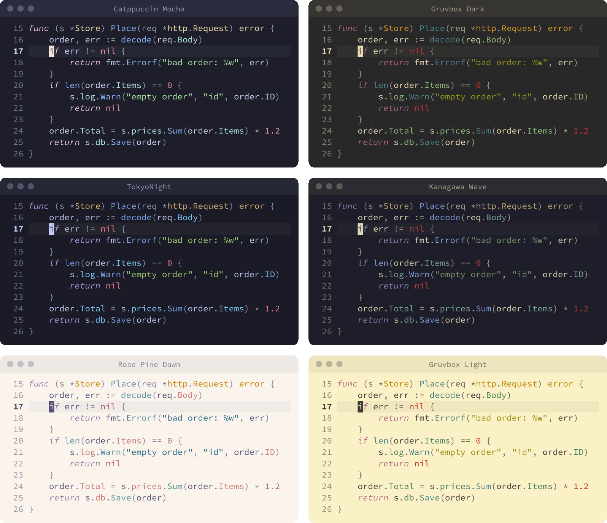

# colorrex.nvim

Compiles the theme your Ghostty / Rex Terminal is showing into a native Neovim colorscheme.
No dependencies, no configuration, no theme files.

https://github.com/user-attachments/assets/c36718b4-fa47-48ef-83bf-e4f948cbc8c3

<p align="center"><sub>Stepping through Rex's theme picker with Neovim open. The code recolors live
as each theme is previewed, with no other configuration.</sub></p>

> **Early days.** colorrex is young and has mostly been built and tested on one
> person's setup, so expect bugs and edge cases nobody has hit yet. The promises
> below are what it is working toward, and the tests hold it to them. If something
> looks wrong, please [report it](#reporting-a-problem).

It works only in terminals built on libghostty, which today means Ghostty and Rex.
In any other terminal it stays grey and says so once.

```lua
vim.cmd.colorscheme("colorrex")
```

That is the whole setup. It asks your terminal for its 19 colors in one request,
and compiles them into over 300 highlight groups.

## The promises

There are three: faithful, practical, and voice. They are goals to work towards.

**Faithful.** Your foreground and background are never altered. Every syntax
color is one of your theme's ANSI colors, unchanged unless it is unreadable. A
color below 3:1 contrast moves in lightness only, the minimum needed, so it
keeps its hue. Text also stays readable on whatever is behind it: a selection, a
highlighted reference, a snippet placeholder and a float all ease off until code and
comments can be read through them, and colored text in a float is lifted against the
float. `:ColorRex explain` shows where any color came from.

**Practical.** Color goes where it tells you something the shape of the text does
not. A field, a method and a variable are all just words, so color separates them:
fields get a color of their own, off the hues of keywords, functions and types, so
`req.Body` shows which part is the object. Every pair of syntax roles can be told
apart, by color where the palette allows and by weight or slant where it does not.
`=` and `self` can be read on sight and appear on nearly every line, so they stay
quiet, and red is left to mean something.

**Voice.** Every theme should look like itself. Each of the twelve chromatic ANSI
colors has a job on screen, and your cursor color is the accent. A colored cursor sets
the theme's voice: it takes the keywords, and the other roles arrange around it.
Without one, roles follow the ANSI convention, the closest thing a terminal theme has
to its author's intent. Either way they move only as far as it takes to keep code
readable. So a difference you can see shows, a difference you cannot see almost never
does, and a family of themes stays a family. Two themes with the same colors read the
same in code, because they are. `:ColorRex status` shows every theme's exact id.

<p align="center">
  
</p>

## Live theme changes

Ghostty reports every config reload, so a new theme applies by itself. Rex reports
only dark and light changes, and nothing at all while its theme picker previews
themes. So while focus is elsewhere, which it is while the picker is open, Neovim
asks the terminal for its colors: every 30ms at first, every 250ms after 5 seconds
with no change, and not at all after a minute with none. Previews show in your code
as you move through the picker. Run `:ColorRex` in one Neovim and every other
Neovim on the machine checks its own terminal too.

## Reporting a problem

Reports help most with these attached:

- the output of `:ColorRex status`, which has the theme's exact id
- `:ColorRex check`
- `:ColorRex explain` with the cursor on a word that looks wrong
- your terminal and its version, your Neovim version, and a screenshot

## Commands

| Command | What it does |
| --- | --- |
| `:ColorRex` | Read the terminal's theme and repaint if it changed |
| `:ColorRex status` | Show the active theme and the last sync |
| `:ColorRex explain [group]` | Show where a group's color came from |
| `:ColorRex check` | Judge the current theme against the promises |
| `:ColorRex compile [name]` | Write a standalone colorscheme that needs no plugin |

Bind any of them. `<Plug>(colorrex)` runs `:ColorRex`, and `status`, `explain`
and `check` have mappings of their own, all running the same code as the command:

```lua
vim.keymap.set("n", "<leader>ts", "<Plug>(colorrex)")
```

## Install

You need Neovim 0.12 or newer, and Ghostty or Rex. With
[lazy.nvim](https://github.com/folke/lazy.nvim), this one line is the whole install:

```lua
{ "reklai/colorrex.nvim" }
```

It loads first, at startup, and turns itself on. Nothing else is required. If you
prefer to spell it out, this is the same thing:

```lua
{ "reklai/colorrex.nvim", lazy = false, priority = 1000, opts = {} }
```

With [LazyVim](https://github.com/LazyVim/LazyVim), also tell it which colorscheme
to use, or it applies its own afterwards:

```lua
-- lua/plugins/colorrex.lua
return {
  { "reklai/colorrex.nvim" },
  { "LazyVim/LazyVim", opts = { colorscheme = "colorrex" } },
}
```

With Neovim's built-in plugin manager:

```lua
vim.pack.add({ "https://github.com/reklai/colorrex.nvim" })
vim.cmd.colorscheme("colorrex")
```

Lualine follows along with `theme = "colorrex"`.

Run `:checkhealth colorrex` to confirm it. In a terminal that does not report its
colors, colorrex stays grey and says so once at startup.

## Options

All optional. In a lazy.nvim spec, pass them as `opts`. Otherwise call `setup`,
which also turns the colorscheme on:

```lua
require("colorrex").setup({
  transparent = true, -- leave the background to the terminal
  contrast = 3.0,     -- minimum contrast for code, up to 4.5
  voice = true,       -- let a theme's cursor color lead its code
  chunks = false,     -- mark where each chunk of code starts
  auto = true,        -- also sync on focus, dark/light changes and picker previews
})
```

Each theme speaks in its own voice. If it gave its cursor a color of its own, that
color takes the keywords, and the other roles follow one of six arrangements modeled on
themes people recognize. It is colorrex's own rule, not what the theme's author meant,
so a theme with a look known from elsewhere can differ from it, though most of those
keep a neutral cursor and are unchanged. Themes whose palettes and cursors nearly match
stay alike. `:ColorRex status` names the voice, `:ColorRex check` says why it was
chosen, and `voice = false` keeps every theme on the ANSI convention.

With `chunks = true`, the name at the start of each chunk stands out, so you can scan
a file by its shape. It works in any language with Treesitter highlighting, because
it reads position in the tree and not kinds of token: in tests a chunk starts at
`describe(...)`, and in source at a function. `if` and `for` are left alone, and only
the outer two levels count, which keeps these to about 5% of lines. They take your
cursor color, so a theme's one signature color marks the shape of the code. A cursor
nearest red gives way to the function color, because red is left to errors.

## How it works

Like libghostty, the part that does the work knows nothing about its host. Only
`lua/colorrex/neovim.lua` has side effects; the compiler and the terminal
protocol run under plain LuaJIT. `test/architecture` pins which module may
depend on which.

```sh
make test     # everything but real terminals
make e2e      # real Neovim in real Rex blocks and Ghostty windows
make matrix   # all of it, against Neovim 0.11.7, 0.12.0, stable and nightly
```

The matrix includes 0.11.7 to prove an older Neovim is refused cleanly, not to
support it.
